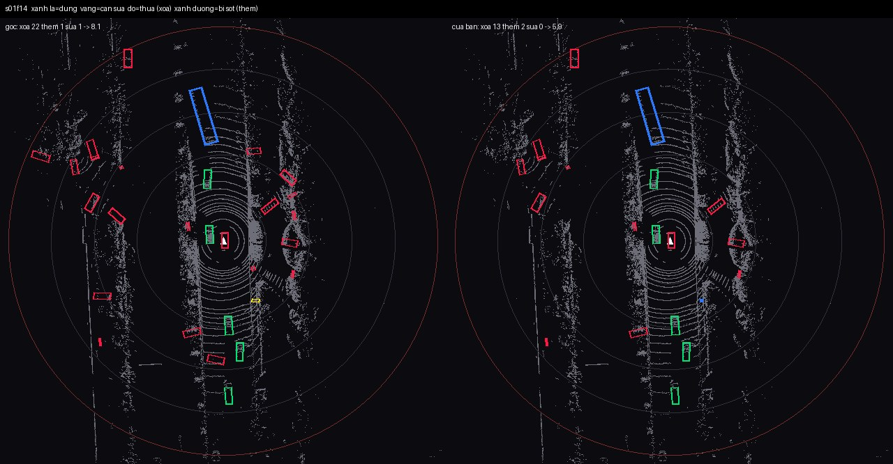

# Báo cáo Day 14 — Nguyễn Thị Hương Giang — 2A202603233

- Mã học viên dùng với `--student`: `233`
- `seed_tag` trong `frames_A.txt`: `393590736f`

## 1. Dự đoán trước sweep (bước 5b)

- Tham số tôi nghĩ giảm công sửa nhiều nhất: `min_points = 5`, `score_thr = 0.2`
- Vì sao:
  1. Số đo cấu hình gốc cho thấy việc xóa box chiếm nhiều chi phí nhất: 33 box
     cần xóa (trọng số 0.3) tương đương 9.9 điểm, chiếm khoảng 64.3% tổng chi phí
     15.4. Thêm box (4 box, 4.0 điểm) chiếm khoảng 26%, sửa box (3 box, 1.5 điểm)
     chiếm khoảng 9.7%. Vì vậy cần tìm cách giảm số box dự đoán thừa.
  2. Theo số đo từng frame, box thừa tập trung ở s01f14: frame này có 22/33 box
     cần xóa (khoảng 66.7%), chi phí 8.1/15.4. Frame đó có 28 box dự đoán (19 Car,
     2 Pedestrian, 7 Cyclist), trong khi s03f07 chỉ cần xóa 7 box và s04f17 chỉ cần
     xóa 4 box. Trên ảnh BEV, các box thừa hiện màu đỏ và không khớp vật thể nào
     trong nhãn chuẩn. Tôi dự đoán phần lớn là các dự đoán có confidence score thấp
     hoặc ít điểm LiDAR. Tổng cộng mô hình dự đoán 71 box trong khi nhãn chuẩn chỉ
     có 42 box.
  3. `min_points` lọc các box theo số điểm LiDAR nằm bên trong box, còn
     `score_thr` lọc các dự đoán theo confidence score. Kết hợp hai tham số này
     loại được các box thừa mà không cần xóa tay.
  4. Rủi ro: các vật thật như Pedestrian và Cyclist, đặc biệt ở xa cảm biến hoặc
     bị che khuất, thường có ít điểm LiDAR và confidence thấp hơn ô tô. Nếu đặt
     ngưỡng quá cao, các vật thật này có thể bị loại nhầm và phải thêm lại bằng
     tay. Vì vậy tôi chọn `min_points = 5` và `score_thr = 0.2` ở mức tương đối
     thấp chứ không chọn mức cao hơn.

## 2. Tập A: sửa tay và tune

Lưới đã quét (24 cấu hình): `score_thr` ∈ {0.1, 0.2, 0.3, 0.4}, `min_points` ∈
{0, 5, 10}, `range_m` ∈ {40, 50}.

Số đo cấu hình gốc theo từng frame (`score_thr = 0.1`, `min_points = 0`,
`range_m = 50`):

| Frame | Xóa | Thêm | Sửa | Chi phí (gốc) | Chi phí (`best_config.json`) |
|---|---:|---:|---:|---:|---:|
| s01f14 | 22 | 1 | 1 | 8.1 | 5.9 |
| s03f07 | 7 | 2 | 2 | 5.1 | 4.5 |
| s04f17 | 4 | 1 | 0 | 2.2 | 2.6 |
| **Tổng** | **33** | **4** | **3** | **15.4** | **13.0** |

| Cấu hình | Xóa | Thêm | Sửa | Chi phí |
|---|---:|---:|---:|---:|
| Gốc | 33 | 4 | 3 | 15.4 |
| `best_config.json` | 20 | 6 | 2 | 13.0 |

- Tham số đã đổi trong `best_config.json`: chỉ có `score_thr`: 0.1 → **0.4**.
  `min_points = 0` và `range_m = 50` giữ nguyên. Với `score_thr = 0.4`, ba giá
  trị `min_points` 0, 5, 10 cho cùng chi phí 13.0 nên `min_points = 0` được giữ.
- Kết quả leave-one-out (chọn cấu hình trên 2 frame còn lại, chấm trên frame bỏ ra):

  ```
  s01f14: cấu hình chọn {score_thr: 0.3, min_points: 5, range_m: 50} → 6.3 (tốt nhất có thể 5.6)
  s03f07: cấu hình chọn {score_thr: 0.4, min_points: 0, range_m: 50} → 4.5 (tốt nhất có thể 4.5)
  s04f17: cấu hình chọn {score_thr: 0.4, min_points: 0, range_m: 40} → 4.6 (tốt nhất có thể 2.2)
  ```

- Cấu hình có ổn định trên từng frame không? Vì sao tôi vẫn chọn nó:
  - **Ổn định một phần.** Cả ba lần leave-one-out đều chọn `score_thr` cao
    (0.3 hoặc 0.4), nên hướng "tăng ngưỡng score" là đáng tin. Nhưng `range_m` không
    ổn định: khi bỏ s04f17 ra, hai frame còn lại chọn `range_m = 40`, và cấu hình
    đó chấm trên s04f17 được 4.6, tệ hơn nhiều so với 2.2 của gốc, vì s04f17
    có nhiều xe ở xa (y ≈ -39 và y ≈ 49.6) bị cắt mất khi giới hạn 40 m.
  - Tổng chi phí leave-one-out là 6.3 + 4.5 + 4.6 = 15.4, bằng đúng cấu hình gốc
    (15.4), nên với 3 frame, quy trình chọn tự động chưa chứng minh được lợi ích.
  - Cấu hình `best_config.json` giảm chi phí trên 2/3 frame (s01f14: 8.1 → 5.9,
    s03f07: 5.1 → 4.5) và làm s04f17 tệ đi một chút (2.2 → 2.6). Tôi vẫn chọn nó
    vì nó cho chi phí thấp nhất trên cả tập A, chỉ đổi một tham số có cơ chế rõ
    ràng (lọc theo confidence), và giữ `range_m = 50` để không mất các xe ở xa.

## 3. Trước/sau (bước 8)



- `scripts/pp_compare.py` báo giảm **15.6%** công sửa trên tập A (chi phí từ 15.4
  xuống 13.0), tương ứng (15.4 − 13.0) / 15.4.
- Dự đoán ở mục 1 đúng hay sai? **Đúng một phần.**
  - Số box xóa giảm từ 33 xuống 20 (tiết kiệm 13 × 0.3 = 3.9 điểm), số box sửa
    giảm từ 3 xuống 2 (tiết kiệm 0.5 điểm), nhưng số box thêm tăng từ 4 lên 6
    (tốn thêm 2 × 1.0 = 2.0 điểm). Tổng: 3.9 + 0.5 − 2.0 = 2.4 điểm, đúng bằng
    15.4 − 13.0.
  - Phần đúng: tham số giảm được công sửa là `score_thr` và hướng dự đoán
    "giảm box thừa" đúng. Phần sai: tôi dự đoán `min_points` cũng góp phần, nhưng
    sweep cho thấy `min_points` gần như không có tác dụng (ở `score_thr = 0.4`
    cả 0, 5, 10 đều ra 13.0). Tôi cũng dự đoán mức `score_thr = 0.2` nhưng thực tế
    0.2 cho kết quả bằng 0.1 (15.4 nếu `min_points = 0`), còn mức 0.4 mới giảm rõ.
  - Cái giá đúng như rủi ro đã nêu ở mục 1: lọc mạnh hơn làm mất thêm 2 vật thật
    (thêm 4 → 6), vì chi phí thêm box (1.0) cao hơn chi phí xóa (0.3).
  - Giải thích vì sao `min_points` không hiệu quả: trên dự đoán của cấu hình gốc,
    tôi ghép box dự đoán với nhãn chuẩn theo khoảng cách tâm dưới 2 m (cách làm
    gần đúng). Khoảng 32 box không khớp nhãn thì chỉ có 1 box có dưới 5 điểm LiDAR,
    phần lớn có từ vài chục đến vài trăm điểm. Nghĩa là box thừa nằm trên vật thể
    có thật trong đám mây điểm nhưng không có trong nhãn, nên lọc theo số điểm
    không loại được. Ngược lại 11/32 box thừa có score dưới 0.4 (từ 0.22 đến 0.39),
    nên `score_thr` mới là tham số hiệu quả. Đồng thời có 3 box khớp nhãn có
    score dưới 0.4 (0.36, 0.38, 0.39), đó chính là những vật thật bị mất khi nâng
    ngưỡng.

## 4. Tập B

Số đo từ `scripts/pp_prelabel.py --frames d14_233/frames_B.txt --config d14_233/best_config.json --gt d14_233/ref_B.json` (12 frame có nhãn: GT 154, dự đoán 214, khớp 129):

| Xóa | Thêm | Sửa | Chi phí |
|---:|---:|---:|---:|
| 85 | 25 | 21 | 61.0 |

- Loại box tốn công sửa nhất ở tập B: **xóa box**, đóng góp 25.5/61.0 điểm
  (khoảng 41.8% chi phí), sát với **thêm box** là 25.0/61.0 (khoảng 41.0%), còn
  sửa box chiếm 10.5/61.0 (khoảng 17.2%). Xét theo số lượng thì xóa chiếm đa số
  (85 trong 131 thao tác), nhưng mỗi box thêm tốn gấp hơn 3 lần một box xóa
  (trọng số 1.0 so với 0.3), nên 25 box thêm có chi phí gần bằng 85 box xóa.
- Tập B vẫn còn nhiều box thừa: mô hình dự đoán 214 box trong khi nhãn chuẩn chỉ
  có 154 box, nên sau khi lọc vẫn còn 85 box cần xóa, đồng thời còn 25 vật thật
  bị bỏ sót.
- Frame tốn công nhất là s01f25 (chi phí 8.1: xóa 7, thêm 5, sửa 2), tiếp theo là
  s05f46 (6.5) và s05f00 (6.0). Riêng s05f00 có tới 6 box cần sửa (nhiều nhất tập)
  và là frame duy nhất có cảnh báo kích thước = 1. Ngược lại s02f54 có 14 box xóa
  nhưng không cần thêm hay sửa, chi phí chỉ 4.2.
- So với tập A: chi phí trung bình/frame là 61.0/12 ≈ 5.08 ở tập B so với
  13.0/3 ≈ 4.33 ở tập A (đã tune). Tập B cao hơn khoảng 17%, đúng với kỳ vọng vì
  cấu hình được chọn trên tập A nên con số ở A hơi lạc quan. Tôi chưa chạy cấu
  hình gốc trên tập B nên không kết luận được cấu hình mới giảm bao nhiêu % ở B,
  chỉ có thể nói chi phí ở B không tệ hơn nhiều so với A.

## 5. Giới hạn

- Chỉ có 3 frame có nhãn để tune, trong đó s01f14 chiếm 22/33 box cần xóa của
  cấu hình gốc. Leave-one-out cho tổng chi phí 15.4, bằng cấu hình gốc, và
  `range_m` bị chọn khác nhau giữa các lần (40 so với 50), nên cấu hình tốt nhất
  có thể bị lệch theo một frame và chưa chắc tổng quát hóa sang dữ liệu khác.
- Lưới tham số nhỏ (24 cấu hình, 3 tham số). Các tham số khác (`nms_thr`,
  `size_pad_m`, `thr_car`/`thr_cyc`/`thr_ped`...) chưa được thử, và ở `score_thr = 0.4`
  `min_points` không tạo khác biệt nên thực chất chỉ `score_thr` đang quyết định kết quả.
- Mô hình KITTI không có lớp Truck/Bus, trong khi nhãn chuẩn của s01f14 có 1
  Bus, nên loại vật thể này phải thêm tay và không thể cải thiện bằng cách chỉnh
  tham số lọc.
- Chi phí chỉ là công thức trọng số (xóa 0.3, thêm 1.0, sửa 0.5), chưa phải thời
  gian sửa thật của người gán nhãn.
- Nâng `score_thr` làm mất thêm vật thật score thấp (thêm 4 → 6 trên tập A), và
  chi phí thêm lại box (1.0) cao hơn nhiều so với xóa (0.3). Ở tập B, 25 box thêm
  đã chiếm khoảng 41% chi phí.
- Tập B rất ít Pedestrian (5 trong 214 dự đoán, so với 172 Car và 37 Cyclist), nên
  số đo gần như không phản ánh được hiệu quả của cấu hình với người đi bộ.
- Chưa có số đo cấu hình gốc trên tập B nên chưa kiểm chứng được mức giảm chi phí
  của `best_config.json` ngoài tập A.